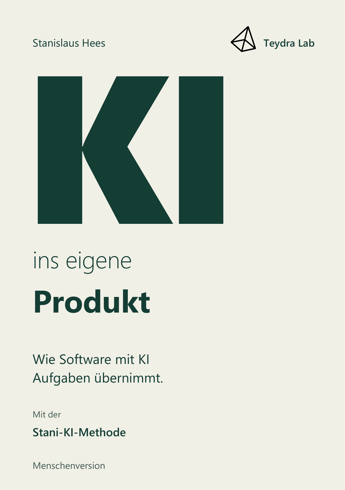

# AI in Your Product

**A book by Stanislaus Hees about building AI into your own software.**

German title: **KI ins eigene Produkt — Wie Software mit KI Aufgaben übernimmt.** The English title is the working translation used for this repository.

The model is one part of the system. The information it can reach, the tools it can use, and the results it receives determine what it can actually do. This book explains how those parts work together, so you can understand and build AI features in your own product.

## The German book is here

**Edition 25 · 253 pages · prologue, introduction, twelve chapters and epilogue.** Every page is available as a PDF, as readable text, and with a matching page for your AI assistant.

| | German (edition 25) |
| --- | --- |
| Read online | [Table of contents](de/human/CONTENTS.md) · [all 253 pages](de/human/pages/25/README.md) |
| Download | [PDF](de/downloads/25/KI_ins_eigene_Produkt_Ausgabe25.pdf) · [human and AI package (ZIP)](de/downloads/25/KI_ins_eigene_Produkt_Menschen_und_KI_Ausgabe25.zip) |
| For your AI assistant | [AI edition](de/ai/README.md) · [one AI page per book page](de/ai/pages/25/README.md) · [knowledge catalogue](de/ai/knowledge/KNOWLEDGE.md) |

## Choose a language and edition

| Language | Human edition | AI edition | Availability |
| --- | --- | --- | --- |
| Deutsch | [Menschenversion](de/human/README.md) | [KI-Version](de/ai/README.md) | Edition 25 published |
| English | [Human edition](en/human/README.md) | [AI edition](en/ai/README.md) | Translation planned |

The human edition is for reading and understanding. The AI edition gives an assistant independent reference material for explaining the book correctly and applying it to your product. Both share the key **book · language · edition · page**, so page 92 of the human edition and page 92 of the AI edition always belong together.

## Read, download, or use with AI

- [All downloads and checksums](DOWNLOADS.md) and [published editions](RELEASES.md).
- [Start here if you are an AI assistant](AI_START.md).
- [Cover assets](assets/covers/README.md).
- [Examples, prompts, templates and glossary](resources/README.md).
- [Corrections](CORRECTIONS.md).

Everything is downloadable without an account or paid login. [book.json](book.json) and [editions.json](editions.json) provide machine-readable discovery.

## Who this is for

People who have started building with AI and want to understand the technical connections that matter. You do not need to learn an entire programming language before beginning; the aim is to understand enough to make sound decisions about your own AI product.

[Reading and AI-assisted use](RIGHTS.md) · [Report a correction](CONTRIBUTING.md)
